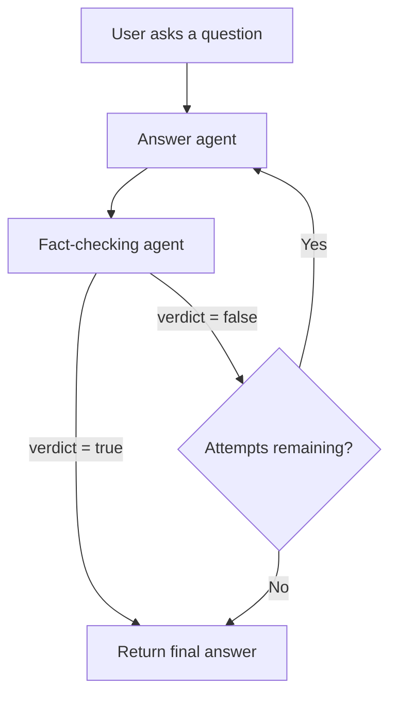
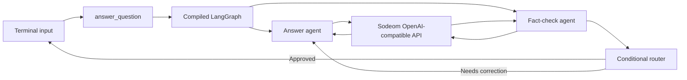
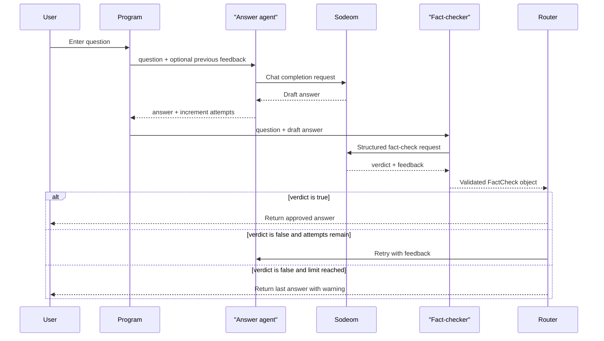
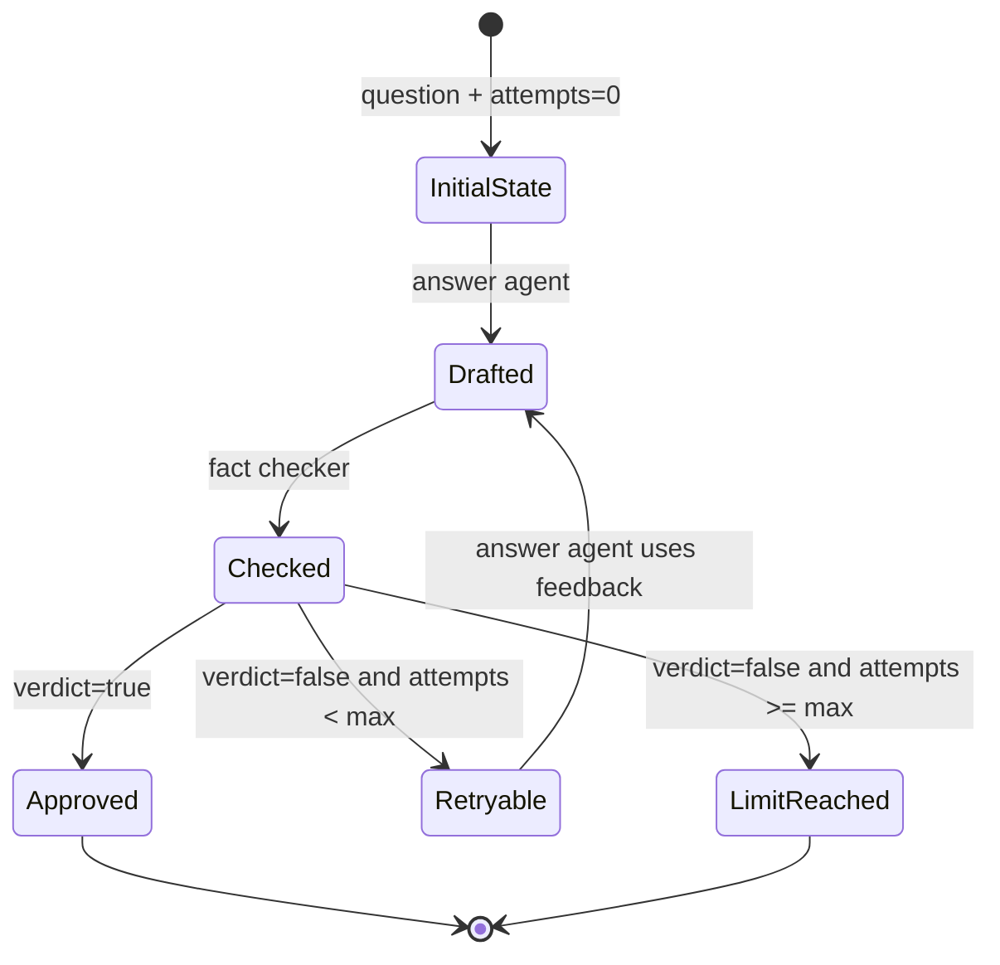
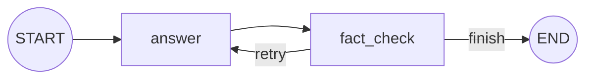
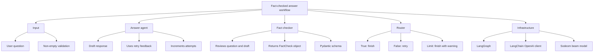

# Fact-Checked LangChain Workflow

> A two-agent question-answering system that drafts an answer, checks its
> accuracy, and retries the draft when the fact checker finds a problem.

## Table of contents

- [What the workflow does](#what-the-workflow-does)
- [Architecture](#architecture)
- [End-to-end flow](#end-to-end-flow)
- [Project files](#project-files)
- [The workflow state](#the-workflow-state)
- [The answer agent](#the-answer-agent)
- [The fact-checking agent](#the-fact-checking-agent)
- [Routing and retry logic](#routing-and-retry-logic)
- [Building the graph](#building-the-graph)
- [Running the program](#running-the-program)
- [Example execution](#example-execution)
- [Configuration](#configuration)
- [Error handling](#error-handling)
- [Important limitations](#important-limitations)

---

## What the workflow does

The program accepts a user question and sends it through two logical agents:

1. **Answer agent** — creates an answer.
2. **Fact-checking agent** — reviews the answer and returns a verdict.

If the verdict is `true`, the workflow finishes.

If the verdict is `false`, the fact-checker's feedback is passed back to the
answer agent so it can produce a better answer. This repeats until:

- the fact checker approves the answer; or
- the maximum number of attempts is reached.

The default maximum is **3 attempts**.



> **Design goal:** improve answer reliability without creating an infinite
> agent loop.

---

## Architecture

The workflow uses:

| Component | Purpose |
|---|---|
| [LangGraph](https://langchain-ai.github.io/langgraph/) | Connects agents and controls the loop |
| `ChatOpenAI` | Sends chat requests to Sodeom's OpenAI-compatible API |
| `Pydantic` | Defines and validates the structured fact-check result |
| `TypedDict` | Defines the shared workflow state |
| `python-dotenv` | Loads optional values from `.env` |

### Component diagram



---

## End-to-end flow



---

## Project files

```text
langchain/
├── main.py             # Workflow implementation and CLI
├── requirements.txt    # Python dependencies
├── .env.example        # Example configuration
├── README.md           # Quick-start instructions
└── explanation.md      # This detailed explanation
```

### `main.py`

This is the executable application. It contains:

- the state definition;
- the answer agent;
- the fact-checking agent;
- the conditional retry router;
- the LangGraph construction;
- the command-line interface.

### `requirements.txt`

```text
langchain-openai>=0.2.0
langgraph>=0.2.0
python-dotenv>=1.0.0
```

### `.env.example`

```dotenv
OPENAI_API_KEY=any
OPENAI_MODEL=beam
OPENAI_BASE_URL=https://sodeom.com/v1
```

The key value `any` is used because Sodeom's documentation says its
OpenAI-compatible endpoint accepts any API key value.

---

## The workflow state

The agents communicate through one shared state object:

```python
class WorkflowState(TypedDict, total=False):
    question: str
    answer: str
    feedback: str
    verdict: Literal["true", "false"]
    attempts: int
```

| Field | Type | Written by | Meaning |
|---|---|---|---|
| `question` | `str` | Entry point | The user's original question |
| `answer` | `str` | Answer agent | The latest generated answer |
| `feedback` | `str` | Fact checker | Corrections or approval message |
| `verdict` | `"true"` / `"false"` | Fact checker | Whether the draft is acceptable |
| `attempts` | `int` | Answer agent | Number of answer drafts generated |

### State lifecycle



---

## The answer agent

The answer agent is implemented inside `build_workflow`:

```python
def answer_agent(state: WorkflowState) -> dict[str, object]:
    retry_context = ""
    if state.get("feedback"):
        retry_context = (
            "\nA previous draft was fact-checked as incorrect. "
            f"Fix these issues:\n{state['feedback']}\n"
        )

    response = model.invoke(
        [
            ("system", "...answer accurately and clearly..."),
            ("human", f"Question: {state['question']}\n..."),
        ]
    )
    return {
        "answer": response.content,
        "attempts": state.get("attempts", 0) + 1,
    }
```

### What it receives

- the original question;
- fact-checker feedback, if this is a retry.

### What it returns

```python
{
    "answer": "The newly generated answer",
    "attempts": 2,
}
```

### Why feedback matters

On the first pass, there is no feedback:

```text
Question: Who discovered penicillin?
```

On a retry, the answer agent receives additional correction context:

```text
Question: Who discovered penicillin?

A previous draft was fact-checked as incorrect.
Fix these issues:
The discovery is generally credited to Alexander Fleming in 1928.
```

This gives the model a concrete reason to revise instead of blindly repeating
the same answer.

---

## The fact-checking agent

The fact checker uses the same chat model, but a different system instruction:

```python
response = model.invoke(
    [
        (
            "system",
            "You are a strict fact-checking agent. Check the draft against "
            "your knowledge and the question. Explain every needed correction.",
        ),
        (
            "human",
            f"Question: {state['question']}\n"
            f"Draft answer:\n{state['answer']}",
        ),
    ]
)
```

The fact checker returns a structured `FactCheck` object:

```python
{
    "verdict": "true",
    "feedback": "The draft answer is correct.",
}
```

For an incorrect answer:

```python
{
    "verdict": "false",
    "feedback": "The answer confuses the date and should say 1928.",
}
```

### Why the code uses function calling

Sodeom supports LangChain structured output through function calling. The
workflow binds the Pydantic schema directly:

```python
fact_checker = model.with_structured_output(
    FactCheck,
    method="function_calling",
)
```

The fact-checking node receives a validated `FactCheck` instance directly:

```python
result = fact_checker.invoke(messages)
```

Using `method="function_calling"` is important for Sodeom. Its default
structured-output mode can return YAML-like text, while the function-calling
method returns the Pydantic-compatible structured result.

The validation model is:

```python
class FactCheck(BaseModel):
    verdict: Literal["true", "false"]
    feedback: str
```

---

## Routing and retry logic

The router decides what happens after fact checking:

```python
def route_after_fact_check(state: WorkflowState) -> str:
    if state.get("verdict") == "true":
        return "finish"
    if state.get("attempts", 0) >= max_attempts:
        return "finish"
    return "retry"
```

| Condition | Route | Result |
|---|---|---|
| `verdict == "true"` | `finish` | End and return the approved answer |
| Verdict is false, attempts remain | `retry` | Generate a corrected answer |
| Verdict is false, limit reached | `finish` | Return the last answer with a warning |

### Retry example

With `max_attempts=3`:

```text
Attempt 1 -> false -> retry
Attempt 2 -> false -> retry
Attempt 3 -> false -> finish with warning
```

The retry cap is important because a model can continue producing an answer
that a strict checker rejects. Without a cap, the graph could loop forever.

---

## Building the graph

The graph has two nodes:

```python
graph = StateGraph(WorkflowState)
graph.add_node("answer", answer_agent)
graph.add_node("fact_check", fact_check_agent)
```

The normal path is:

```python
graph.add_edge(START, "answer")
graph.add_edge("answer", "fact_check")
```

The conditional edge creates the loop:

```python
graph.add_conditional_edges(
    "fact_check",
    route_after_fact_check,
    {"retry": "answer", "finish": END},
)
```

In graph form:



Finally, the graph is compiled:

```python
return graph.compile()
```

Compilation turns the node and edge definitions into an executable workflow.

---

## Running the program

### 1. Create a virtual environment

```bash
python -m venv .venv
source .venv/bin/activate
```

On Windows PowerShell:

```powershell
python -m venv .venv
.venv\Scripts\Activate.ps1
```

### 2. Install dependencies

```bash
pip install -r requirements.txt
```

### 3. Configure Sodeom

Copy the example file:

```bash
cp .env.example .env
```

The default configuration is:

```dotenv
OPENAI_API_KEY=any
OPENAI_MODEL=beam
OPENAI_BASE_URL=https://sodeom.com/v1
```

### 4. Start the CLI

```bash
python main.py
```

Then enter a question:

```text
Ask a question: What is the capital of France?
```

---

## Example execution

### Approved on the first attempt

```text
Ask a question: What is the capital of France?

Answer:
Paris

Fact-check verdict: true
Attempts: 1
```

### Corrected after a retry

```text
Ask a question: Who discovered penicillin?

Answer:
Alexander Fleming is generally credited with discovering penicillin in 1928.

Fact-check verdict: true
Attempts: 2
```

### Retry limit reached

```text
Ask a question: ...

Answer:
The last generated answer appears here.

Fact-check verdict: false
Attempts: 3

Warning: the retry limit was reached before the fact checker approved the answer.
```

---

## Calling it from Python

The CLI is not required. Another Python file can call the workflow directly:

```python
from main import answer_question

result = answer_question(
    "What is the largest planet in our solar system?",
    max_attempts=3,
)

print(result["answer"])
print(result["verdict"])
print(result["attempts"])
```

The returned state can contain:

```python
{
    "question": "What is the largest planet in our solar system?",
    "answer": "Jupiter is the largest planet in the solar system.",
    "feedback": "The draft answer is correct.",
    "verdict": "true",
    "attempts": 1,
}
```

---

## Configuration

| Environment variable | Default | Description |
|---|---|---|
| `OPENAI_API_KEY` | `any` | Credential value passed to the OpenAI client |
| `OPENAI_MODEL` | `beam` | Sodeom model name |
| `OPENAI_BASE_URL` | `https://sodeom.com/v1` | OpenAI-compatible API base URL |

The model is initialized with deterministic settings:

```python
model = ChatOpenAI(
    model=os.getenv("OPENAI_MODEL", "beam"),
    base_url=os.getenv("OPENAI_BASE_URL", "https://sodeom.com/v1"),
    api_key=os.getenv("OPENAI_API_KEY", "any"),
    temperature=0,
)
```

`temperature=0` is used to make the answer and fact-checking behavior more
consistent across runs. It does **not** guarantee identical results.

---

## Error handling

### Empty questions

```python
if not question.strip():
    raise ValueError("question must not be empty")
```

The workflow rejects blank input before making an API request.

### Invalid attempt limits

```python
if max_attempts < 1:
    raise ValueError("max_attempts must be at least 1")
```

At least one answer attempt is required.

### Structured-output failures

```python
result = fact_checker.invoke(messages)
```

LangChain raises an error if the model response cannot be converted into the
`FactCheck` schema. The failure is not silently treated as an approval.

---

## Important limitations

> [!WARNING]
> The fact checker is another language-model call. It is not a guaranteed
> source of truth.

### No external evidence retrieval

The current implementation checks answers against the model's knowledge. It
does not search the web, query a database, or attach citations.

For stronger verification, add tools such as:

- web search;
- a trusted documentation retriever;
- a vector database;
- an internal knowledge base;
- a human approval step.

### The two agents use the same model

The answer agent and fact checker are logically separate but use the same
`ChatOpenAI` instance. This improves simplicity and reduces configuration
duplication, but it does not provide independent model diversity.

### False answers can still pass

A fact checker can make mistakes or accept an inaccurate draft. The workflow
reduces errors; it does not eliminate them.

### Retry limit behavior

When all attempts are rejected, the program returns the last answer and prints
a warning. In a production system, you may prefer to:

1. return an explicit failure instead;
2. ask the user to rephrase the question;
3. invoke a web-backed verifier;
4. route the case to human review.

---

## Summary



The core idea is simple:

> **Draft → check → retry when needed → return a bounded result.**
